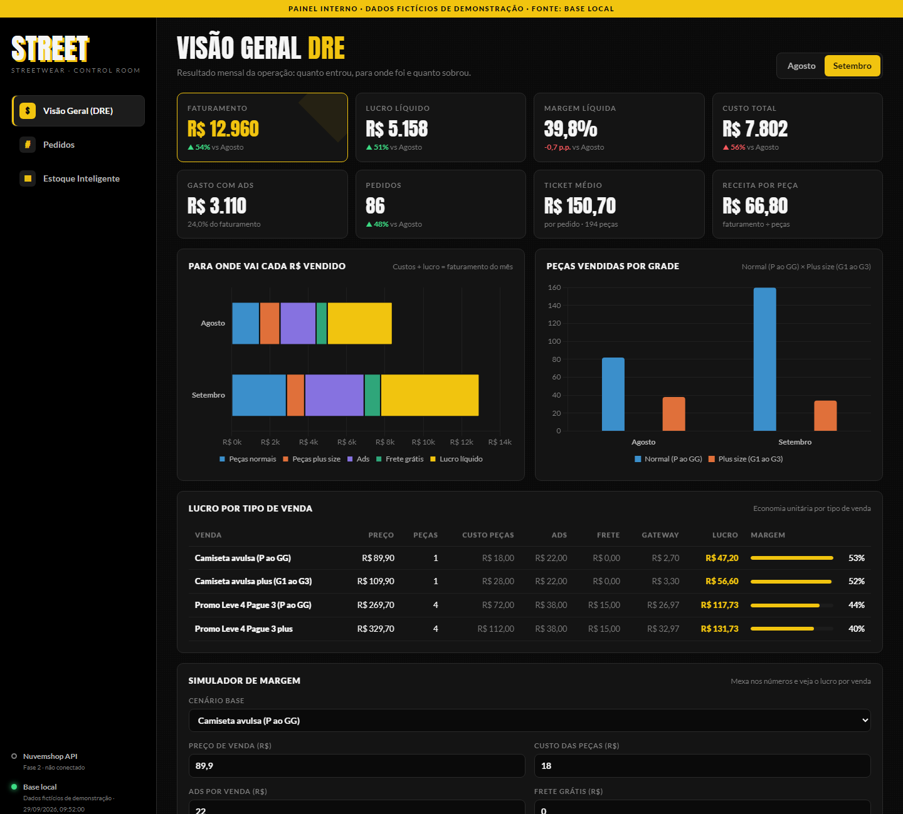
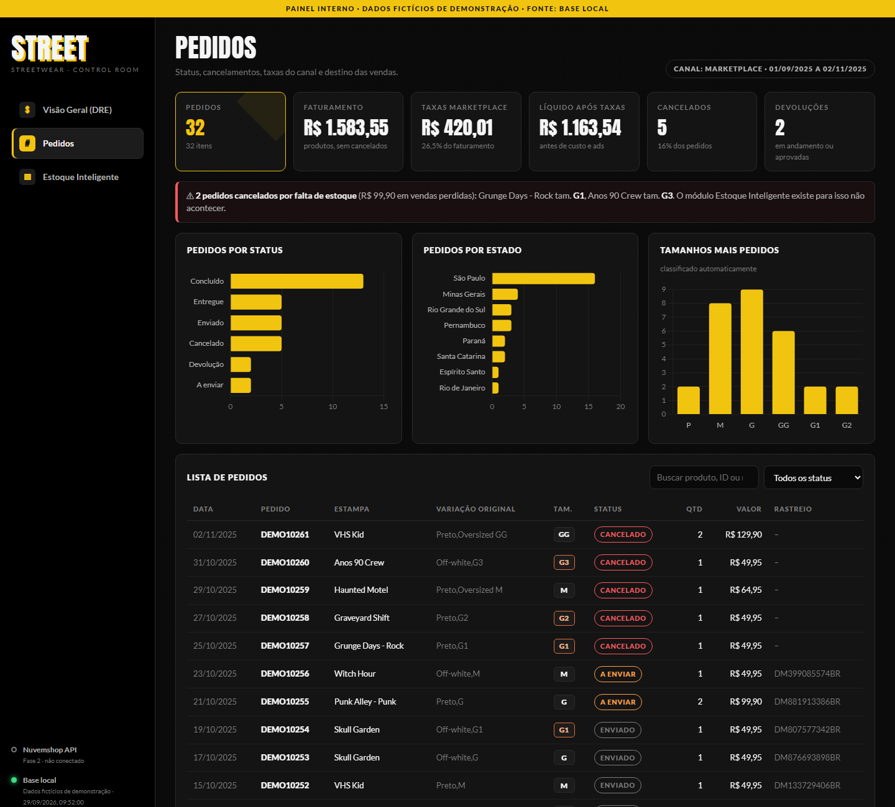
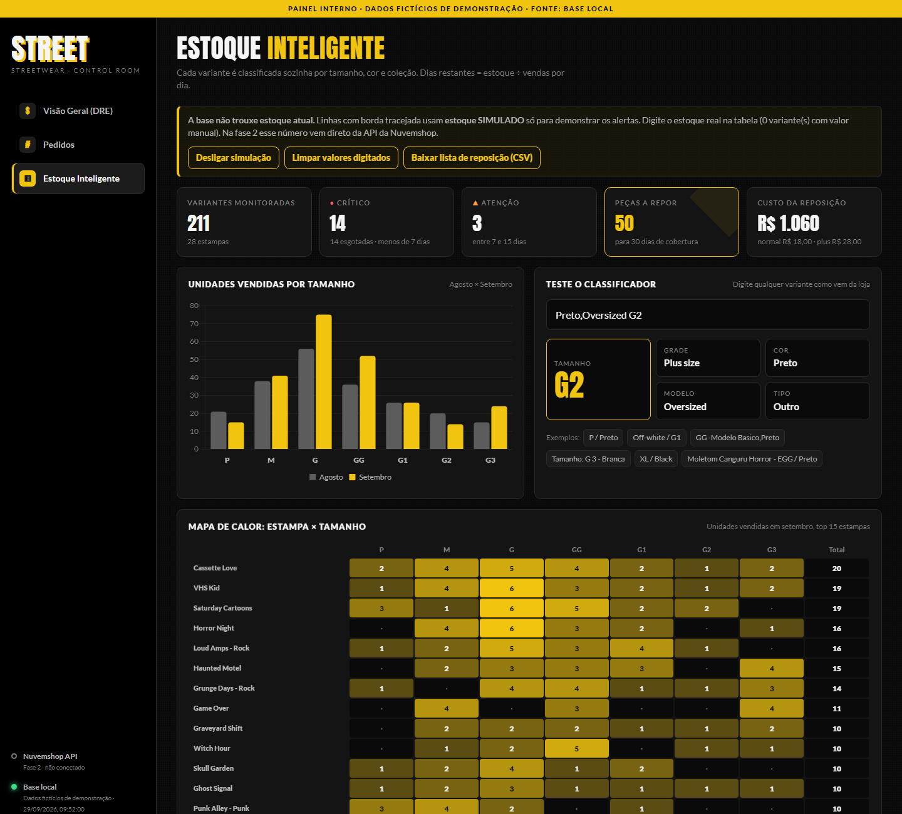

# Painel de Estoque Streetwear

Painel interno para loja de roupas em e-commerce: resultado financeiro (DRE), pedidos e **estoque inteligente com classificação automática de variantes** (tamanho, grade, cor, modelo, tipo de peça e coleção).

> Todos os dados deste repositório são **fictícios**, gerados por `scripts/gerar_demo.py`.



## O que tem

**Visão Geral (DRE)**
- Faturamento, lucro, margem, custo, ads, ticket médio, com comparação ao mês anterior
- Gráfico "para onde vai cada R$ vendido" (custos + lucro = faturamento)
- Lucro por tipo de venda (avulsa, plus size, promoção leve 4 pague 3) e simulador de margem

**Pedidos**
- Status, estados de destino, tamanhos mais pedidos, taxas do canal
- Alerta de pedidos cancelados por falta de estoque
- Lista com busca e filtro



**Estoque Inteligente**
- Cada variante é classificada sozinha a partir do texto que vem da loja
- Velocidade de venda, dias restantes de estoque, status (Crítico, Atenção, OK, Excesso) e quantidade a repor
- Mapa de calor estampa × tamanho, filtros por tamanho, coleção e status
- Estoque editável por linha e exportação da lista de reposição em CSV
- Campo para testar o classificador ao vivo



## Classificador de variantes

`js/classificador.js` recebe textos livres e devolve dados estruturados:

| Entrada | Tamanho | Grade | Cor | Modelo |
|---|---|---|---|---|
| `P / Preto` | P | Normal | Preto | Tradicional |
| `Preto,Oversized GG` | GG | Normal | Preto | Oversized |
| `Off-white / G1` | G1 | Plus size | Off-white | Tradicional |
| `Tamanho: G 3 - Branca` | G3 | Plus size | Branco | Tradicional |
| `XL / Black` | GG | Normal | Preto | Tradicional |
| `EGG / Preta` | G2 | Plus size | Preto | Tradicional |

Sinônimos de mercado (S, L, XL, XG, EG, EGG, 2XL...) são convertidos para a grade PP, P, M, G, GG, G1 a G4. Se a variante não tiver tamanho, ele é buscado no nome do produto. Funciona no navegador e no Node.

```bash
node tests/classificador.test.js
```

## Rodar

```bash
python scripts/gerar_demo.py
python -m http.server 5510 --bind 127.0.0.1
```

Abrir `http://localhost:5510`. Sem build e sem dependências (Chart.js via CDN).

## Estrutura

| Caminho | Função |
|---|---|
| `index.html`, `css/style.css` | Layout dark, responsivo (desktop e celular) |
| `js/classificador.js` | Classificação automática de variantes |
| `js/fonte-dados.js` | Camada de dados: hoje lê `js/data.js`; trocando `MODO` para `"api"` passa a consumir o backend sem mudar o resto do front |
| `js/app.js` | Telas e gráficos |
| `server/nuvemshop.js` | Cliente da API Nuvemshop para o backend (pedidos, produtos, atualização de estoque, webhooks com HMAC, retry em limite de requisições) |
| `scripts/gerar_demo.py` | Gera os dados fictícios |

### Formato do `js/data.js`

```js
window.PAINEL_DATA = {
  fonte, geradoEm, canalPedidos,
  dre: { meses, vendas, gastoAds, pedidos, pecasNormais, pecasPlus, custoNormal, custoPlus,
         freteGratis, custoTotal, lucroLiquido, lucroPct, pctAds, receitaPorPeca, custoPeca },
  unitario: [{ nome, preco, pecas, custoPecas, ads, frete, gateway, lucro, margem }],
  pedidos: [{ id, status, motivoCancelamento, devolucao, rastreio, data, produto, variacao,
              quantidade, subtotal, taxaComissao, taxaServico, taxaTransacao, uf }],
  vendas: { agosto: [{ produto, variante, unidades, estoque, receita }], setembro: [...] }
};
```

## Próxima fase: integração com a Nuvemshop

Arquitetura planejada: Next.js na Vercel + Supabase (Postgres, Auth, RLS) + Sentry.

```
Nuvemshop ──webhooks──▶ /api/webhooks/nuvemshop ──▶ Postgres
    ▲                       (valida HMAC)               │ RLS por loja e papel
    │ PUT estoque                                       ▼
 Backend /api (Vercel) ◀──── cookie de sessão ──── Painel (Next.js)
    └── Cron a cada 15 min reconcilia pedidos e produtos
```

| Tema | Decisão |
|---|---|
| Segredos | Token da loja só no servidor; o navegador fala apenas com `/api/*` |
| Dados | RLS em todas as tabelas; usuário só enxerga lojas em que é membro |
| Acesso | Supabase Auth; papéis `dono` (tudo) e `socio` (leitura, edição opcional) |
| Versionamento | `main` protegida, PR com deploy de preview, rollback instantâneo, migrações versionadas |
| Integração | Webhooks `order/created`, `order/paid`, `order/cancelled`, `product/updated` + cron de reconciliação |
| Segurança | Rate limit no login e na API, validação com zod, erro genérico ao usuário |
| Cache | Painel lê do banco, não da API a cada acesso; views materializadas para indicadores |
| Observabilidade | Sentry no front e no back, alerta em falha de webhook ou cron |

### Endpoints Nuvemshop usados

Base `https://api.nuvemshop.com.br/v1/{store_id}`, headers `Authentication: bearer {token}` e `User-Agent`.

| Objetivo | Endpoint |
|---|---|
| Sincronizar pedidos | `GET /orders?updated_at_min=...&per_page=200` |
| Produtos e variantes com estoque | `GET /products?per_page=200` |
| Atualizar estoque | `PUT /products/{product_id}/variants/{variant_id}` com `{"stock": n}` |
| Webhooks | `POST /webhooks` com `{"event": "order/paid", "url": "..."}` |

Documentação: https://tiendanube.github.io/api-documentation/
